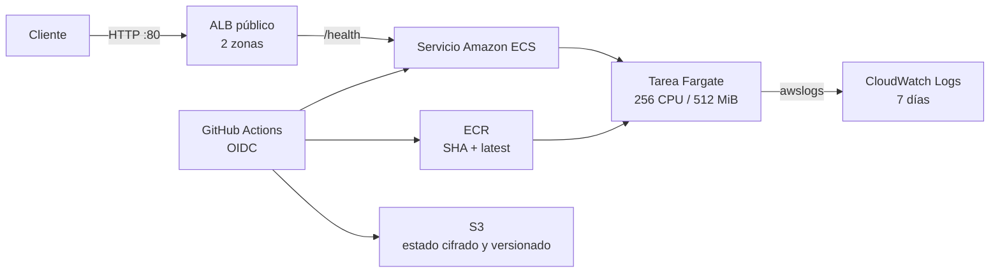

# Taller 3: API contenerizada en AWS ECS Fargate — DOMUSNET

API pequeña en FastAPI desplegada como contenedor en Amazon ECS Fargate. Terraform define la infraestructura y GitHub Actions automatiza pruebas, análisis de seguridad y despliegues mediante OIDC.

## Estado actual del proyecto

El repositorio ya muestra un avance sólido y consistente con un taller de despliegue en AWS. Hasta este momento se ha documentado y dejado preparado lo siguiente:

- Aplicación FastAPI con endpoints básicos: `/health`, `/info` y `/`.
- Contenedor Docker para la API.
- Infraestructura como código en Terraform con VPC, subredes, ALB, ECS Fargate, ECR, logs y permisos IAM.
- Bootstrap de Terraform para crear el bucket del estado y la confianza OIDC con GitHub Actions.
- Workflows de GitHub para validar infra, desplegar app y escanear seguridad con Trivy/Checkov.
- Documentación técnica en README y archivos Markdown dentro de `docs/`.

Este proyecto está en una fase de preparación y validación de infraestructura: la base técnica está implementada y documentada, pero la evidencia final de ejecución real en AWS sigue siendo un punto pendiente de cumplimentar con capturas, URLs y resultados de despliegue.

## Arquitectura



El ALB atiende en HTTP y distribuye al puerto 8000 de las tareas. Las tareas se ejecutan en dos subredes públicas con IP pública, pero su security group solo admite tráfico entrante desde el ALB.

## Avance implementado

### 1. Aplicación

- `app/main.py` expone los endpoints `/health`, `/info` y `/`.
- El servicio registra solicitudes con logging y devuelve metadatos del servicio y del equipo.
- `app/Dockerfile` establece el contenedor para la API FastAPI.

### 2. Infraestructura

- `infra/terraform/` incluye:
  - VPC y redes.
  - ALB y listener HTTP.
  - ECS cluster y servicio Fargate.
  - Repositorio ECR.
  - IAM con rol OIDC para GitHub Actions.
  - Logs de CloudWatch.
  - Backend remoto S3 con bloqueo y cifrado.

### 3. Seguridad y calidad

- Se usa Checkov para validar infraestructura.
- Se usa Trivy para escaneo de vulnerabilidades, secretos y configuración.
- Los workflows fuerzan controles mínimos y uso de OIDC, evitando credenciales estáticas.


### 4. Automatización

El proyecto utiliza GitHub Actions para automatizar la validación de infraestructura, la publicación de la aplicación y los análisis de seguridad.

Se utilizan tres workflows independientes:

#### 4.1. Infraestructura: infra-deploy.yml

Archivo: `.github/workflows/infra-deploy.yml`

Este workflow administra los recursos de AWS definidos mediante Terraform.

Se divide en tres trabajos:

**validate — Validación**

Se ejecuta cuando se crea un Pull Request que modifica la infraestructura.

Realiza las siguientes comprobaciones:

- Descarga el código del repositorio.
- Configura Terraform.
- Verifica el formato con `terraform fmt`.
- Inicializa los proveedores sin utilizar el backend remoto.
- Comprueba la configuración con `terraform validate`.
- Analiza los archivos de infraestructura con Checkov.

Este trabajo no necesita credenciales de AWS.

**deploy — Despliegue**

Se ejecuta cuando los cambios se integran en las ramas principales configuradas o cuando se solicita una ejecución manual autorizada.

Sus pasos son:

1. Comprueba las variables necesarias de GitHub.
2. Obtiene credenciales temporales de AWS mediante OIDC.
3. Verifica la identidad con AWS STS.
4. Inicializa Terraform utilizando el backend remoto de S3.
5. Ejecuta `terraform plan`.
6. Aplica el mismo plan generado mediante `terraform apply`.
7. Publica los outputs de infraestructura.

El trabajo utiliza el entorno protegido `aws-infrastructure`, que permite solicitar aprobación antes de comenzar el despliegue.

**destroy — Destrucción manual**

Permite eliminar la infraestructura principal mediante una ejecución manual del workflow.

Requiere seleccionar la opción de destrucción, escribir la confirmación `DESTROY DOMUSNET` y obtener la aprobación del entorno protegido.

Esta operación no debe utilizarse durante los despliegues habituales. El bucket utilizado por el bootstrap debe conservarse mientras el equipo dependa del estado remoto.

#### 4.2. Aplicación: app-deploy.yml

Archivo: `.github/workflows/app-deploy.yml`

Este workflow automatiza la publicación de la API en AWS.

Su funcionamiento contempla:

- Ejecución de pruebas de Python.
- Construcción de la imagen Docker.
- Análisis de seguridad de la imagen con Trivy.
- Publicación de la imagen en Amazon ECR.
- Actualización de la definición de tarea de ECS.
- Despliegue del servicio en Fargate.
- Comprobación de disponibilidad de la aplicación.

#### 4.3. Seguridad: security-scan.yml

Archivo: `.github/workflows/security-scan.yml`

Realiza análisis de seguridad del repositorio mediante Trivy.

Permite detectar vulnerabilidades, secretos expuestos y problemas de configuración.

Los resultados se almacenan como un artefacto SARIF para facilitar su revisión.

#### 4.4. Flujo general de CI/CD

El proceso de infraestructura comienza con una modificación en Terraform y una solicitud de revisión mediante Pull Request.

GitHub ejecuta las validaciones y Checkov antes de permitir integrar los cambios.

Una vez aprobado e integrado el Pull Request, se activa el despliegue de infraestructura. El entorno protegido solicita la aprobación correspondiente antes de ejecutar el trabajo que realiza el plan y el apply.

La publicación de la aplicación se gestiona mediante un workflow independiente, que construye y publica nuevas imágenes Docker y actualiza el servicio ECS.


## Prerrequisitos

- Cuenta AWS y permisos locales del equipo para aplicar una vez `infra/bootstrap`.
- Terraform 1.10 o posterior, AWS CLI configurado localmente para el bootstrap y Docker.
- Repositorio GitHub `ISCOUTB/API-contenerizada-en-AWS-ECS-Fargate` y acceso para configurar variables y ejecutar Actions.
- Las acciones de GitHub requieren que la confianza OIDC corresponda a ese repositorio y a las ramas `main`/`master`.


## Orden de despliegue

El despliegue del proyecto se realiza en el siguiente orden:

1. **Preparación del entorno:** instalar Terraform, AWS CLI y Docker, y comprobar los permisos de la cuenta AWS del equipo.
2. **Bootstrap inicial:** ejecutar una sola vez el módulo `infra/bootstrap` con credenciales autorizadas. Este procedimiento crea el bucket S3 para el estado y configura la identidad OIDC.
3. **Configuración de GitHub:** registrar las variables necesarias del repositorio y crear el entorno protegido `aws-infrastructure`.
4. **Despliegue de infraestructura:** realizar los cambios de Terraform, abrir un Pull Request, revisar las validaciones e integrar los cambios aprobados.
5. **Aprobación del despliegue:** autorizar la ejecución del entorno protegido en GitHub.
6. **Publicación de la aplicación:** ejecutar el workflow `app-deploy.yml` para construir la imagen Docker, publicarla en ECR y actualizar ECS.
7. **Verificación:** comprobar la disponibilidad de la API mediante los endpoints `/health` y `/info`, y revisar los registros de CloudWatch.

El bootstrap es independiente de la infraestructura principal y no debe eliminarse durante las operaciones normales de mantenimiento.


## Configuración de GitHub

Todas son variables de repositorio en Settings → Secrets and variables → Actions → Variables. No se requieren secrets de credenciales.

| Nombre | Tipo | Valor |
|---|---|---|
| `AWS_ROLE_ARN` | Variable | ARN de `github_actions_role_arn` generado por el bootstrap |
| `AWS_REGION` | Variable | Región de despliegue; por defecto `us-east-1` |
| `TF_STATE_BUCKET` | Variable | Nombre del bucket S3 creado por el bootstrap |
| `TF_STATE_KEY` | Variable | Clave del estado, por ejemplo `domusnet/ecs-fargate/terraform.tfstate` |

## Variables de Terraform

| Variable | Predeterminado | Descripción |
|---|---:|---|
| `aws_region` | `us-east-1` | Región de AWS |
| `project_name` | `domusnet-api` | Prefijo de nombres y etiquetas |
| `environment` | `dev` | Entorno |
| `team_name` | `DOMUSNET` | Etiqueta de equipo |
| `app_port` | `8000` | Puerto de la aplicación |
| `desired_count` | `1` | Tareas Fargate deseadas |
| `cpu` | `256` | CPU Fargate |
| `memory` | `512` | Memoria Fargate en MiB |
| `log_retention_days` | `7` | Retención CloudWatch |
| `image_tag` | `latest` | Imagen usada por la task definition inicial |


### Entorno protegido para despliegues

Además de las variables de repositorio, se debe configurar un entorno de GitHub llamado `aws-infrastructure`.

Ruta de configuración:

`Settings → Environments → New environment`

El entorno debe tener:

- Nombre: `aws-infrastructure`.
- Un revisor obligatorio, si la configuración y el plan de GitHub lo permiten.
- Restricción de despliegues a las ramas principales autorizadas.

Los trabajos `deploy` y `destroy` de `infra-deploy.yml` utilizan este entorno para controlar el acceso a las operaciones de infraestructura.

La configuración de confianza OIDC en IAM debe coincidir con el contexto del entorno protegido.

## API y verificación

La API expone `GET /health` (`{"status":"ok"}`), `GET /info` (servicio, versión `APP_VERSION` y equipo) y `GET /` (bienvenida). Las solicitudes se registran en stdout y llegan a CloudWatch.

Después del despliegue, obtenga `api_url` en los outputs del workflow y pruebe:

```bash
curl http://<DNS-del-ALB>/health
curl http://<DNS-del-ALB>/info
```

Para ejecutar pruebas y la aplicación localmente:

```bash
cd app
python -m pip install -r requirements.txt
python -m pytest -q
uvicorn main:app --reload
```

## Workflows y controles

- `app-deploy.yml`: ejecuta pruebas, construye y publica la imagen, y despliega la API en ECS.
- `infra-deploy.yml`: valida Terraform, ejecuta Checkov y aplica infraestructura.
- `security-scan.yml`: escanea el código con Trivy.

Se fijan versiones de las Actions y se usan permisos mínimos. Checkov y Trivy se ejecutan antes de desplegar, y se evita almacenaje de credenciales por medio de OIDC.

## Evidencias y cierre del taller

El proyecto ya dispone de la estructura y de la documentación teórica necesaria para el taller, pero el cierre formal requiere evidencia operativa real. Debe documentarse al menos:

1. URL pública del ALB tras despliegue.
2. Respuesta de `/health` y `/info`.
3. SHA de la imagen publicada en ECR.
4. Resultado del análisis Trivy.
5. Resultado del plan de Terraform o ejecución real.
6. Capturas de CloudWatch y del workflow ejecutado.

Use la plantilla de [`docs/EVIDENCIAS.md`](docs/EVIDENCIAS.md) para documentar este cierre.


## Destrucción y limpieza

La eliminación de recursos de la infraestructura principal se realiza mediante el workflow `infra-deploy.yml`.

El procedimiento requiere:

1. Abrir el workflow en GitHub Actions.
2. Seleccionar `Run workflow`.
3. Ejecutarlo desde una rama principal autorizada.
4. Activar la opción `destroy`.
5. Escribir `DESTROY DOMUSNET` en el campo de confirmación.
6. Obtener la aprobación del entorno protegido `aws-infrastructure`.

Antes de realizar esta operación, el equipo debe comprobar qué recursos serán eliminados y asegurarse de que no se necesiten.

Después de la destrucción, se debe verificar en AWS la eliminación de los recursos principales.

El bucket S3 del bootstrap y el estado remoto deben conservarse mientras sean necesarios para administrar la infraestructura.


## Costos y control

Fargate en 256 CPU / 512 MiB con una tarea y CloudWatch de siete días mantiene bajo el consumo, pero el ALB tiene costo fijo por hora más cargos por LCU; por tanto, la infraestructura debe destruirse cuando termine el laboratorio.

## Conclusión

La base funcional del proyecto está avanzada y documentada. La decisión más importante ahora es cerrar la validación real en AWS con evidencias concretas para demostrar el flujo completo: infraestructura, despliegue, seguridad y disponibilidad.

