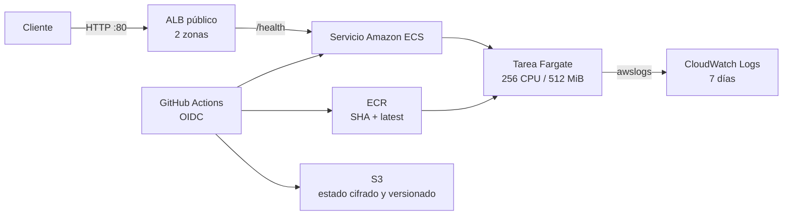

# Taller 3: API contenerizada en AWS ECS Fargate — DOMUSNET

API pequeña en FastAPI desplegada como contenedor en Amazon ECS Fargate. Terraform define la infraestructura y GitHub Actions automatiza pruebas, análisis de seguridad y despliegues mediante OIDC.

## Estado actual del proyecto

El repositorio ya muestra un avance sólido y consistente con un taller de despliegue en AWS. Hasta este momento se ha documentado y dejado preparado lo siguiente:

- Aplicación FastAPI con endpoints básicos: `/health`, `/info` y `/`.
- Contenedor Docker para la API.
- Infraestructura como código en Terraform con VPC, subredes, ALB, ECS Fargate, ECR, logs y permisos IAM.
- Bootstrap de Terraform para crear el bucket del estado y la confianza OIDC con GitHub Actions.
- Workflows de GitHub para validar infra, desplegar app y escanear seguridad con Trivy/Checkov.
- Documentación técnica en README y archivos Markdown dentro de `docs/`.

Este proyecto está en una fase de preparación y validación de infraestructura: la base técnica está implementada y documentada, pero la evidencia final de ejecución real en AWS sigue siendo un punto pendiente de cumplimentar con capturas, URLs y resultados de despliegue.

## Arquitectura



El ALB atiende en HTTP y distribuye al puerto 8000 de las tareas. Las tareas se ejecutan en dos subredes públicas con IP pública, pero su security group solo admite tráfico entrante desde el ALB.

## Avance implementado

### 1. Aplicación

- `app/main.py` expone los endpoints `/health`, `/info` y `/`.
- El servicio registra solicitudes con logging y devuelve metadatos del servicio y del equipo.
- `app/Dockerfile` establece el contenedor para la API FastAPI.

### 2. Infraestructura

- `infra/terraform/` incluye:
  - VPC y redes.
  - ALB y listener HTTP.
  - ECS cluster y servicio Fargate.
  - Repositorio ECR.
  - IAM con rol OIDC para GitHub Actions.
  - Logs de CloudWatch.
  - Backend remoto S3 con bloqueo y cifrado.

### 3. Seguridad y calidad

- Se usa Checkov para validar infraestructura.
- Se usa Trivy para escaneo de vulnerabilidades, secretos y configuración.
- Los workflows fuerzan controles mínimos y uso de OIDC, evitando credenciales estáticas.

### 4. Automatización

- `app-deploy.yml`: prueba la app, construye imagen, escanea vulnerabilidades, publica en ECR y despliega a ECS.
- `infra-deploy.yml`: valida Terraform, ejecuta Checkov y aplica/destroye infraestructura según corresponda.
- `security-scan.yml`: escanea el repositorio y genera SARIF.

## Prerrequisitos

- Cuenta AWS y permisos locales del equipo para aplicar una vez `infra/bootstrap`.
- Terraform 1.10 o posterior, AWS CLI configurado localmente para el bootstrap y Docker.
- Repositorio GitHub `ISCOUTB/API-contenerizada-en-AWS-ECS-Fargate` y acceso para configurar variables y ejecutar Actions.
- Las acciones de GitHub requieren que la confianza OIDC corresponda a ese repositorio y a las ramas `main`/`master`.

## Orden de despliegue

1. Bootstrap local, una sola vez. Siga [`infra/bootstrap/README.md`](infra/bootstrap/README.md).
2. Configurar variables del repositorio: `AWS_ROLE_ARN`, `AWS_REGION`, `TF_STATE_BUCKET` y `TF_STATE_KEY`.
3. Desplegar infraestructura desde el workflow de Terraform.
4. Publicar la aplicación desde el workflow de la API.
5. Verificar `GET /health` y `/info` desde el ALB.

## Configuración de GitHub

Todas son variables de repositorio en Settings → Secrets and variables → Actions → Variables. No se requieren secrets de credenciales.

| Nombre | Tipo | Valor |
|---|---|---|
| `AWS_ROLE_ARN` | Variable | ARN de `github_actions_role_arn` generado por el bootstrap |
| `AWS_REGION` | Variable | Región de despliegue; por defecto `us-east-1` |
| `TF_STATE_BUCKET` | Variable | Nombre del bucket S3 creado por el bootstrap |
| `TF_STATE_KEY` | Variable | Clave del estado, por ejemplo `domusnet/ecs-fargate/terraform.tfstate` |

## Variables de Terraform

| Variable | Predeterminado | Descripción |
|---|---:|---|
| `aws_region` | `us-east-1` | Región de AWS |
| `project_name` | `domusnet-api` | Prefijo de nombres y etiquetas |
| `environment` | `dev` | Entorno |
| `team_name` | `DOMUSNET` | Etiqueta de equipo |
| `app_port` | `8000` | Puerto de la aplicación |
| `desired_count` | `1` | Tareas Fargate deseadas |
| `cpu` | `256` | CPU Fargate |
| `memory` | `512` | Memoria Fargate en MiB |
| `log_retention_days` | `7` | Retención CloudWatch |
| `image_tag` | `latest` | Imagen usada por la task definition inicial |

## API y verificación

La API expone `GET /health` (`{"status":"ok"}`), `GET /info` (servicio, versión `APP_VERSION` y equipo) y `GET /` (bienvenida). Las solicitudes se registran en stdout y llegan a CloudWatch.

Después del despliegue, obtenga `api_url` en los outputs del workflow y pruebe:

```bash
curl http://<DNS-del-ALB>/health
curl http://<DNS-del-ALB>/info
```

Para ejecutar pruebas y la aplicación localmente:

```bash
cd app
python -m pip install -r requirements.txt
python -m pytest -q
uvicorn main:app --reload
```

## Workflows y controles

- `app-deploy.yml`: ejecuta pruebas, construye y publica la imagen, y despliega la API en ECS.
- `infra-deploy.yml`: valida Terraform, ejecuta Checkov y aplica infraestructura.
- `security-scan.yml`: escanea el código con Trivy.

Se fijan versiones de las Actions y se usan permisos mínimos. Checkov y Trivy se ejecutan antes de desplegar, y se evita almacenaje de credenciales por medio de OIDC.

## Evidencias y cierre del taller

El proyecto ya dispone de la estructura y de la documentación teórica necesaria para el taller, pero el cierre formal requiere evidencia operativa real. Debe documentarse al menos:

1. URL pública del ALB tras despliegue.
2. Respuesta de `/health` y `/info`.
3. SHA de la imagen publicada en ECR.
4. Resultado del análisis Trivy.
5. Resultado del plan de Terraform o ejecución real.
6. Capturas de CloudWatch y del workflow ejecutado.

Use la plantilla de [`docs/EVIDENCIAS.md`](docs/EVIDENCIAS.md) para documentar este cierre.

## Destrucción y limpieza

1. Ejecutar `infra-deploy.yml` con `destroy=true` si se desea eliminar el entorno de laboratorio.
2. Confirmar en AWS la eliminación del ALB, ECS, VPC y ECR.
3. Revisar el bucket S3 del estado antes de borrarlo, teniendo en cuenta versiones y delete markers.

## Costos y control

Fargate en 256 CPU / 512 MiB con una tarea y CloudWatch de siete días mantiene bajo el consumo, pero el ALB tiene costo fijo por hora más cargos por LCU; por tanto, la infraestructura debe destruirse cuando termine el laboratorio.

## Conclusión

La base funcional del proyecto está avanzada y documentada. La decisión más importante ahora es cerrar la validación real en AWS con evidencias concretas para demostrar el flujo completo: infraestructura, despliegue, seguridad y disponibilidad.

