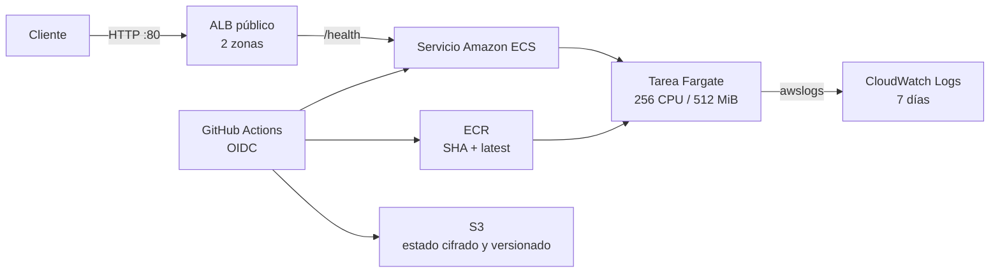

# Taller 3: API contenerizada en AWS ECS Fargate — DOMUSNET

API pequeña en FastAPI desplegada como contenedor en Amazon ECS Fargate. Terraform define la infraestructura y GitHub Actions automatiza pruebas, análisis de seguridad y despliegues mediante OIDC, sin access keys persistentes.

## Arquitectura



El ALB atiende en HTTP y distribuye al puerto 8000 de las tareas. Las tareas se ejecutan en dos subredes públicas con IP pública, pero su security group solo admite tráfico entrante desde el ALB. No se usa NAT Gateway. El diseño es didáctico y no debe manejar datos sensibles ni considerarse listo para producción. Consulte [la explicación detallada](docs/arquitectura.md) y [las decisiones y limitaciones](docs/DECISIONES.md).

## Prerrequisitos

- Cuenta AWS y permisos locales del equipo para aplicar una vez `infra/bootstrap`.
- Terraform 1.10 o posterior, AWS CLI configurado localmente para el bootstrap y Docker.
- Repositorio GitHub `ISCOUTB/API-contenerizada-en-AWS-ECS-Fargate` y acceso para configurar variables y ejecutar Actions.
- Las acciones de GitHub requieren que la confianza OIDC corresponda a ese repositorio y a la rama `main`.

## Orden de despliegue

1. **Bootstrap local, una sola vez.** Siga [`infra/bootstrap/README.md`](infra/bootstrap/README.md). Elija un nombre globalmente único para `state_bucket_name`, aplique el módulo localmente y guarde de manera segura su estado local.
2. **Configurar variables del repositorio.** Agregue `AWS_ROLE_ARN`, `AWS_REGION`, `TF_STATE_BUCKET` y `TF_STATE_KEY` como variables de Actions. La sección de configuración las describe. No agregue access keys.
3. **Desplegar infraestructura.** Revise `infra/terraform/terraform.tfvars.example`; el workflow usa los valores por defecto o el archivo tfvars que se decida mantener localmente. Abra un pull request para validar formato, Terraform, Checkov y obtener un plan. Al integrar cambios de `infra/terraform/**` en `main`, Actions ejecuta `terraform apply`.
4. **Publicar la aplicación.** El workflow se activa en `main` cuando cambia `app/**`; también se puede iniciar manualmente. Ejecuta pytest y escanea la imagen con Trivy antes de iniciar sesión en ECR y publicarla. Luego actualiza y espera la estabilidad del servicio ECS.

La definición de tarea inicial apunta a `<URL-del-repositorio-ECR>:latest`. En la primera creación de infraestructura esa imagen aún podría no existir; ECS reintenta iniciar tareas y el primer workflow de la app publica `latest` y despliega una revisión con el SHA del commit. Si el circuit breaker declara fallida la revisión inicial, vuelva a ejecutar el workflow de aplicación una vez publicada la imagen.

## Configuración de GitHub

Todas son **variables de repositorio** en Settings → Secrets and variables → Actions → Variables. No se requieren secrets de credenciales.

| Nombre | Tipo | Valor |
|---|---|---|
| `AWS_ROLE_ARN` | Variable | ARN de `github_actions_role_arn` generado por el bootstrap |
| `AWS_REGION` | Variable | Región de despliegue; por defecto `us-east-1` |
| `TF_STATE_BUCKET` | Variable | Nombre del bucket S3 creado por el bootstrap |
| `TF_STATE_KEY` | Variable | Clave del estado, por ejemplo `domusnet/ecs-fargate/terraform.tfstate` |

El proveedor OIDC solo permite el repositorio definido en el bootstrap y los sujetos de `main` y `pull_request`. GitHub Actions recibe credenciales STS temporales.

## Variables de Terraform

| Variable | Predeterminado | Descripción |
|---|---:|---|
| `aws_region` | `us-east-1` | Región de AWS |
| `project_name` | `domusnet-api` | Prefijo de nombres y etiquetas |
| `environment` | `dev` | Entorno |
| `team_name` | `DOMUSNET` | Etiqueta de equipo |
| `app_port` | `8000` | Puerto de la aplicación |
| `desired_count` | `1` | Tareas Fargate deseadas |
| `cpu` | `256` | CPU Fargate |
| `memory` | `512` | Memoria Fargate en MiB |
| `log_retention_days` | `7` | Retención CloudWatch |
| `image_tag` | `latest` | Imagen usada por la task definition inicial |

El backend S3 no recibe credenciales en Terraform: `bucket`, `key` y `region` se inyectan con `-backend-config` desde las variables del repositorio.

## API y verificación

La API expone `GET /health` (`{"status":"ok"}`), `GET /info` (servicio, versión `APP_VERSION` y equipo) y `GET /` (bienvenida). Las solicitudes se registran en stdout y llegan a CloudWatch.

Después del despliegue, obtenga `api_url` en los outputs del workflow y pruebe:

```bash
curl http://<DNS-del-ALB>/health
curl http://<DNS-del-ALB>/info
```

Para ejecutar pruebas y la aplicación localmente:

```bash
cd app
python -m pip install -r requirements.txt
python -m pytest -q
uvicorn main:app --reload
```

## Workflows y controles

- **`app-deploy.yml`:** para cambios en `app/**` en `main` o ejecución manual. Corre pytest, construye tags SHA y `latest`, analiza la imagen con Trivy (HIGH/CRITICAL, sin publicar si falla), inicia sesión OIDC en ECR, publica y despliega la revisión ECS; espera estabilidad y prueba `/health`.
- **`infra-deploy.yml`:** para cambios en `infra/terraform/**`, pull request, push a `main` o ejecución manual. Ejecuta `terraform fmt -check`, `init`, `validate` y Checkov. En PR publica un plan en el resumen; en `main` aplica y presenta outputs. La opción manual `destroy` inicia la destrucción controlada de la infraestructura principal.
- **`security-scan.yml`:** en pull request y push a `main`, escanea el sistema de archivos por vulnerabilidades, secretos y misconfiguraciones; almacena el resultado SARIF como artefacto.

Se fijan versiones de las Actions, los workflows declaran permisos mínimos (`contents: read` y, donde se asume el rol, `id-token: write`) y usan OIDC, nunca access keys. Checkov se ejecuta antes de plan/aplicación; las excepciones justificadas están anotadas en Terraform y en [`docs/DECISIONES.md`](docs/DECISIONES.md). Los recursos etiquetables reciben `Team`, `Project` y `Environment` mediante `default_tags`. ECR cifra imágenes, analiza al publicar y conserva las diez más recientes.

## Demostración y evidencias

1. Cambie una respuesta o metadato de la API en `app/`, integre a `main` y capture pruebas, ejecución de Trivy, SHA y respuesta actualizada.
2. Modifique una propiedad de `infra/terraform/`, abra PR y capture el plan; al integrar, capture la aplicación y sus outputs.
3. Consulte las ejecuciones de los tres workflows y adjunte el artefacto SARIF y el resumen Checkov. No publique credenciales ni datos sensibles.
4. Compruebe que la API sigue accesible y que `/health` responde `200` después de desplegar una imagen nueva.
5. Revise el grupo `/ecs/domusnet-api-dev-api` en CloudWatch Logs.

Use la plantilla de [`docs/EVIDENCIAS.md`](docs/EVIDENCIAS.md) para reunir capturas y enlaces.

## Destrucción y limpieza

1. Ejecute `infra-deploy.yml` manualmente con `destroy=true` y confirme que el entorno de laboratorio se puede eliminar. Esto destruye los recursos principales y el repositorio ECR (incluidas sus imágenes por `force_delete`), pero no elimina el bucket bootstrap.
2. Confirme en AWS que ALB, servicio/cluster ECS, VPC, ECR y log group se eliminaron.
3. Si el equipo decide retirar también el bootstrap, hágalo manualmente desde `infra/bootstrap` con las credenciales del equipo después de retirar el estado principal y verificar que ningún workflow lo necesita. `prevent_destroy` protege el bucket; no lo elimine por accidente.
4. Antes de eliminar el bucket de estado, borre de forma consciente todas sus versiones y delete markers: versionado conserva objetos anteriores incluso si se borra el objeto actual. Luego elimine el bucket y el proveedor/rol OIDC si ya no se necesitan.

No se ejecutan comandos de AWS ni de destrucción como parte de este repositorio; el equipo debe revisar planes y recursos antes de confirmar la limpieza.

## Costos y control

Fargate en 256 CPU / 512 MiB con una tarea y CloudWatch de siete días mantiene bajo el consumo, pero **el ALB tiene costo fijo por hora más cargos por LCU** y continúa facturando incluso sin tráfico. El importe depende de región, horas y tráfico; en regiones como `us-east-1`, el componente horario del ALB suele ser del orden de **USD 16–20 al mes** si permanece encendido todo el mes, antes de LCU, Fargate, transferencia y logs. Verifique precios actuales en la calculadora oficial de AWS. Para limitar costos, destruya los recursos de laboratorio al terminar, no use NAT Gateway, conserve la retención breve y aplique la política de ciclo de vida de ECR.
