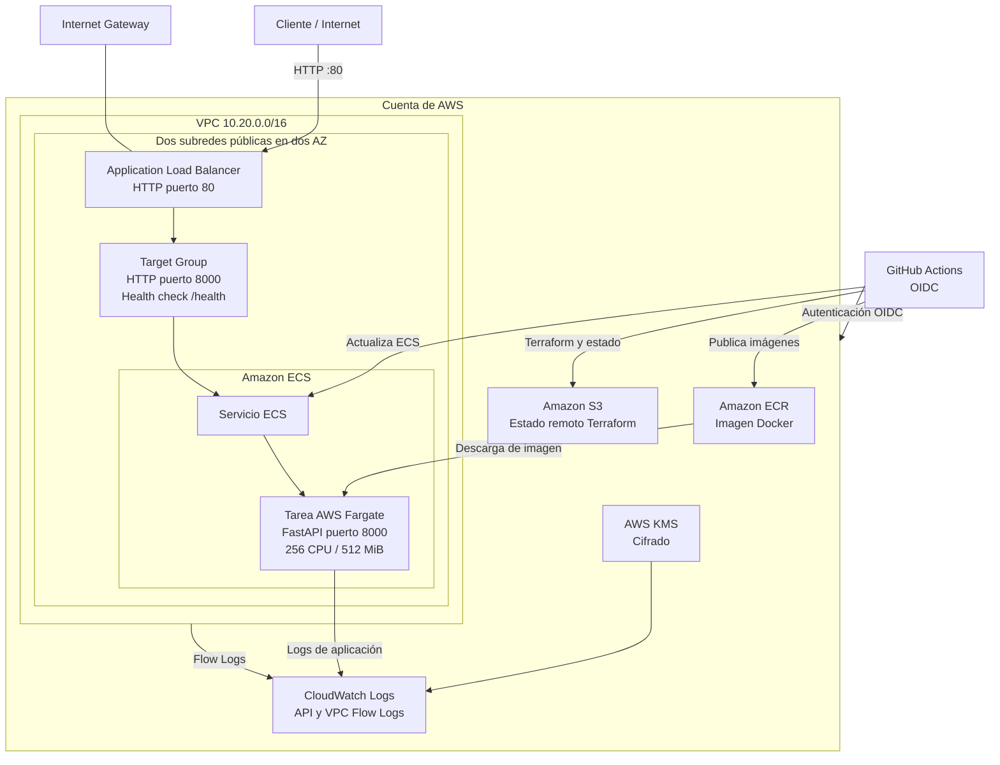

# Arquitectura de DOMUSNET

## 1. Descripción general

DOMUSNET es una API desarrollada con FastAPI y desplegada como contenedor en Amazon ECS utilizando AWS Fargate.

La infraestructura se define mediante Terraform, mientras que GitHub Actions automatiza la validación, el análisis de seguridad y el despliegue.

La arquitectura utiliza servicios de AWS para administrar la red, ejecutar la aplicación, almacenar las imágenes Docker y centralizar los registros.

## 2. Diagrama de arquitectura

## 3. Componentes de la infraestructura

### 3.1. Amazon VPC

Se utiliza una VPC con el rango de direcciones IP 10.20.0.0/16.

Dentro de esta red se crean dos subredes públicas distribuidas en dos zonas de disponibilidad.

La VPC cuenta con un Internet Gateway y una tabla de rutas que permite la comunicación con Internet.

No se utiliza NAT Gateway para reducir los costos del entorno académico.

### 3.2. Application Load Balancer

El Application Load Balancer recibe las solicitudes HTTP mediante el puerto 80.

Su función es distribuir las solicitudes hacia las tareas de la aplicación que se ejecutan en ECS Fargate.

Utiliza un Target Group configurado para recibir tráfico en el puerto 8000.

El health check consulta el endpoint /health para comprobar que la API esté disponible.

### 3.3. Amazon ECS y AWS Fargate

Amazon ECS administra el clúster, la definición de tarea y el servicio de la aplicación.

AWS Fargate ejecuta los contenedores sin necesidad de administrar servidores EC2.

La configuración predeterminada de la tarea utiliza:

- CPU: 256 unidades.
- Memoria: 512 MiB.
- Tipo de lanzamiento: Fargate.
- Cantidad deseada: una tarea.
- Puerto de la aplicación: 8000.

El servicio incorpora un mecanismo de despliegue y reversión automática cuando una actualización no logra estabilizarse.

### 3.4. Amazon ECR

Amazon Elastic Container Registry almacena las imágenes Docker utilizadas por la aplicación.

Las imágenes se publican con dos etiquetas:

- SHA del commit para identificar una versión específica.
- latest para la versión más reciente.

El repositorio tiene análisis de imágenes al momento de la publicación y una política de ciclo de vida que conserva las diez imágenes más recientes.

### 3.5. Seguridad y grupos de seguridad

La seguridad de red se administra mediante Security Groups.

El balanceador permite conexiones HTTP desde Internet por el puerto 80.

Las tareas Fargate únicamente permiten conexiones entrantes desde el Security Group del balanceador, mediante el puerto 8000.

El tráfico de salida de las tareas se limita a los puertos necesarios para HTTPS y DNS.

Las credenciales de GitHub Actions se obtienen mediante OIDC, evitando almacenar claves permanentes de AWS en el repositorio.

### 3.6. AWS IAM

IAM administra los permisos necesarios para los servicios.

Se utilizan roles separados para:

- Ejecución de las tareas ECS.
- Acceso de la aplicación a los servicios que necesita.
- Envío de registros de VPC Flow Logs.
- Acceso de GitHub Actions mediante OIDC.

### 3.7. Amazon CloudWatch

CloudWatch almacena los registros generados por la aplicación y por la VPC.

Se configuran grupos de logs para:

- Registros de la API.
- VPC Flow Logs.

Los registros utilizan cifrado mediante AWS KMS y una retención predeterminada de siete días.

### 3.8. Amazon S3

Amazon S3 se utiliza para almacenar el estado remoto de Terraform.

El bucket se prepara mediante el módulo bootstrap y cuenta con:

- Cifrado.
- Versionado.
- Bloqueo del acceso público.
- Bloqueo del estado mediante el mecanismo nativo de Terraform.

El bucket bootstrap se mantiene separado de la infraestructura principal para evitar eliminar el estado durante una operación de destrucción.

## 4. Flujo de funcionamiento de la aplicación

1. El cliente realiza una solicitud HTTP.
2. El Application Load Balancer recibe la solicitud.
3. El balanceador la dirige al servicio ECS.
4. ECS administra la tarea que ejecuta FastAPI en Fargate.
5. La aplicación procesa la petición y devuelve la respuesta.
6. Los registros de ejecución se envían a CloudWatch.

ECR proporciona la imagen Docker utilizada por la definición de tarea.

## 5. Flujo de automatización CI/CD

El repositorio utiliza tres workflows de GitHub Actions.

### 5.1. infra-deploy.yml

Se encarga de la infraestructura.

Ejecuta:

- Verificación de formato con Terraform.
- Inicialización de proveedores.
- Validación de configuración.
- Análisis de seguridad con Checkov.
- Autenticación AWS mediante OIDC.
- Terraform plan y apply.
- Publicación de outputs.

El despliegue requiere una aprobación mediante el entorno protegido configurado en GitHub.

### 5.2. app-deploy.yml

Se encarga de automatizar la publicación de la aplicación.

Su proceso contempla:

- Ejecución de pruebas.
- Construcción de imagen Docker.
- Análisis de seguridad con Trivy.
- Publicación de imágenes en ECR.
- Actualización del servicio ECS Fargate.
- Comprobación de disponibilidad de la API.

### 5.3. security-scan.yml

Realiza análisis de seguridad del repositorio mediante Trivy.

Permite identificar vulnerabilidades, secretos y problemas de configuración.

Los resultados se almacenan como evidencia del análisis.

## 6. Decisiones y limitaciones de arquitectura

La arquitectura se diseñó para un entorno académico, priorizando la automatización y el control de costos.

Entre sus principales decisiones se encuentran:

- Uso de Fargate para evitar administrar servidores.
- Subredes públicas para simplificar la conectividad y evitar NAT Gateway.
- ALB público para permitir probar la API.
- HTTP sin TLS debido a que el taller no incluye dominio ni certificado.
- Retención limitada de logs para controlar costos.
- Uso de OIDC para evitar credenciales permanentes.

Esta configuración no debe considerarse una arquitectura de producción para información sensible.

## 7. Estado de implementación

La infraestructura se encuentra definida en Terraform y cuenta con workflows preparados para automatizar su administración.

La validación local de Terraform puede comprobar la sintaxis y estructura de los archivos, pero no demuestra por sí sola que los servicios estén desplegados en AWS.

La finalización del proyecto requiere ejecutar los workflows con la cuenta del equipo, verificar los recursos y documentar los resultados reales en docs/EVIDENCIAS.md.

