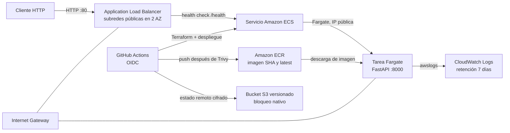

# Arquitectura

## Estado actual de implementación

El repositorio refleja un proyecto ya avanzado en su construcción. En este punto se ha dejado implementado lo siguiente:

- Aplicación web en FastAPI con endpoints básicos para salud e información.
- Imagen Docker que ejecuta la API en el puerto 8000.
- Infraestructura de red y seguridad con VPC, subredes públicas, internet gateway y grupos de seguridad.
- Balanceador ALB público y reglas para reenviar tráfico a la tarea Fargate.
- Servicio ECS con ejecución en Fargate.
- Repositorio ECR con etiquetado por SHA y `latest`.
- Políticas IAM para que GitHub Actions asuma el rol con OIDC.
- Estado remoto Terraform en S3 con versionado y cifrado.
- Workflows de validación, despliegue y análisis de seguridad.

## Componentes y flujo

- Una VPC contiene dos subredes públicas en zonas de disponibilidad distintas, un Internet Gateway y rutas a Internet. No hay NAT Gateway para evitar su costo fijo. Las tareas reciben IP pública.
- El ALB recibe HTTP por el puerto 80 y reenvía al puerto de la API en un target group `ip`. El health check consulta `GET /health`.
- Un servicio ECS ejecuta una tarea Fargate con 256 CPU y 512 MiB. El security group de tareas solo permite ingreso desde el security group del ALB. El grupo de logs tiene retención configurable y se centraliza en CloudWatch.
- ECR almacena la imagen, analiza cada publicación y conserva las imágenes más recientes. Las acciones publican el SHA y `latest` luego de pasar Trivy.
- Terraform mantiene el estado principal en S3 con versionado, cifrado y bloqueo nativo de archivos `.tflock`. El rol de GitHub se asume con OIDC; no se almacenan access keys.

La API usa HTTP sin TLS para mantener el taller sencillo y económico. No debe transportar información sensible ni considerarse una configuración de producción.

## Alcance funcional alcanzado

El proyecto ya está listo para demostrar un ciclo completo de despliegue en AWS, siempre que la infraestructura se aplique en un entorno con permisos adecuados. La parte funcional completada incluye:

- Contrucción del artefacto de aplicación.
- Validación de la app con pruebas.
- Despliegue automatizado vía GitHub Actions.
- Seguridad con Trivy y Checkov.
- Observabilidad y logs con CloudWatch.

## Limitaciones actuales

- La arquitectura está orientada a laboratorio y no a entorno productivo.
- El ALB y las tareas usan red pública por simplicidad y costo.
- La evidencia final del taller aún debe completarse con ejecuciones y capturas reales.
- La validación final de la solución requiere la ejecución efectiva del pipeline en AWS.

## Estado general

Se puede considerar que el proyecto está en una fase de madurez intermedia: la solución técnica ya está diseñada y montada; el siguiente paso es validar y documentar la ejecución real de las automatizaciones y la disponibilidad de la API en producción de laboratorio.

