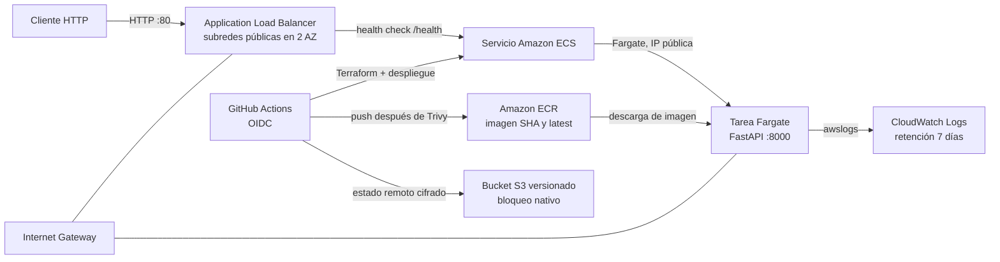

# Arquitectura

## Componentes y flujo

- Una VPC contiene dos subredes públicas en zonas de disponibilidad distintas, un Internet Gateway y rutas a Internet. No hay NAT Gateway para evitar su costo fijo. Las tareas reciben IP pública para descargar imágenes de ECR y enviar logs.
- El ALB recibe HTTP por el puerto 80 y reenvía al puerto de la API en un target group `ip`. El health check consulta `GET /health`.
- Un servicio ECS ejecuta una tarea Fargate con 256 CPU y 512 MiB. El security group de tareas solo permite ingreso desde el security group del ALB. El grupo de logs tiene retención configurable, siete días por defecto.
- ECR almacena la imagen, analiza cada publicación y conserva las diez imágenes más recientes. Las acciones publican el SHA y `latest` luego de pasar Trivy.
- Terraform mantiene el estado principal en S3 con versionado, cifrado y bloqueo nativo de archivos `.tflock`. El rol de GitHub se asume con OIDC; no se almacenan access keys.

La API usa HTTP sin TLS para mantener el taller sencillo y económico. No debe transportar información sensible ni considerarse una configuración de producción.
